  

  
  
  

## about

The two selection tasks for the core team of the **Kharagpur Data Analytics Group**, solved without reaching for a
library that already does the job.

## notebooks

| notebook | what it does | open |
|:--|:--|:--|
| [`Kdag_Task1.ipynb`](Kdag_Task1.ipynb) | Survey responses full of misspelt career names. Levenshtein edit distance implemented by hand, each response mapped to the closest of ten careers, then counted and plotted. |  |
| [`kdag_Task2.ipynb`](kdag_Task2.ipynb) | Night-time satellite imagery as a proxy for road networks. k-means clustering written from scratch with OpenCV and NumPy: random centroid initialisation, nearest-centroid assignment, update until convergence. |  |

## data

Task 1 reads `tassk1.xlsx` (the survey sheet handed out with the task). Task 2's test images are linked from inside
the notebook.

---

  Part of <a href="https://github.com/Madmins07">Madmins07</a> · Madhav Agarwal · IIT Kharagpur

